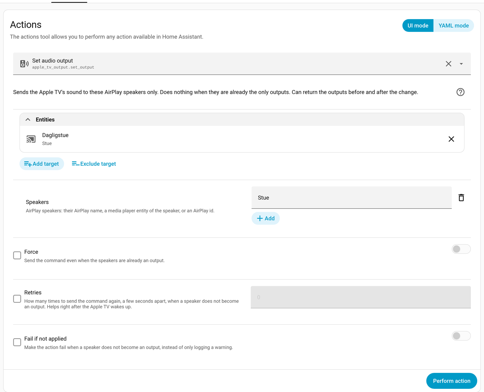
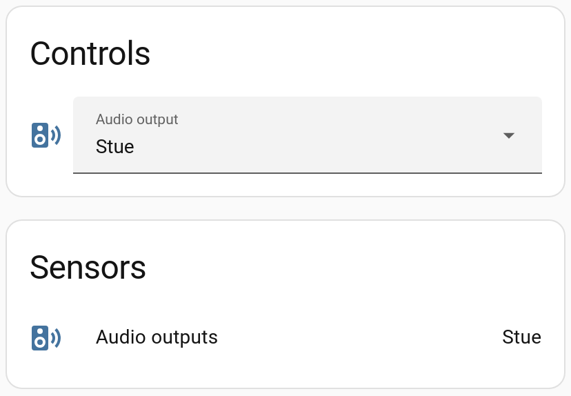

# Apple TV Audio Output

[](https://hacs.xyz)
[](https://github.com/Emilhaurum/ha-apple-tv-output/releases)
[](https://github.com/Emilhaurum/ha-apple-tv-output/actions/workflows/validate.yml)
[](LICENSE)

A Home Assistant integration that sends an Apple TV's sound to AirPlay 2 speakers. It is tested with
an Apple TV 4K and Sonos speakers on Home Assistant 2026.11.

tvOS only remembers a HomePod as its default audio output. Any other AirPlay speaker has to be picked
again by hand after the Apple TV has slept. Home Assistant's Apple TV integration cannot do it for
you, because it has no way to choose the audio output. This integration pairs with the Apple TV and
can send the sound to your speakers every time it wakes up, with no automation needed. It also adds
actions, a sensor and a dropdown for the audio output.



## Requirements

- Home Assistant 2025.1 or newer (tested on 2026.11).
- The Apple TV on the same network as Home Assistant. This integration pairs with it itself; the
  built-in [Apple TV integration](https://www.home-assistant.io/integrations/apple_tv/) is not needed,
  but can stay set up alongside it.
- The Apple TV must be able to reach the speaker over AirPlay. If you can pick the speaker by hand
  on the Apple TV, it will work. See [Troubleshooting](#troubleshooting) if you cannot.

## Installation

### HACS

[](https://my.home-assistant.io/redirect/hacs_repository/?owner=Emilhaurum&repository=ha-apple-tv-output&category=integration)

1. Select the button above to open the repository in HACS, or search for **Apple TV Audio Output**
   in HACS. If HACS does not find it, open the menu, choose **Custom repositories**, and add
   `https://github.com/Emilhaurum/ha-apple-tv-output` with the type **Integration**.
2. Select **Download**, and restart Home Assistant.

### Manual

Copy `custom_components/apple_tv_output` into the `custom_components` folder of your Home Assistant
configuration and restart Home Assistant.

### Set up

[](https://my.home-assistant.io/redirect/config_flow_start/?domain=apple_tv_output)

Select the button above, or go to **Settings → Devices & services → Add integration** and add
**Apple TV Audio Output**. Choose your Apple TV from the list, then type the PIN it shows on the TV.
To add another Apple TV, select **Add device** on the integration's page and do the same.

If the Apple TV is reset, or the pairing is removed on it (**Settings → Remotes and Devices** on the
Apple TV), Home Assistant asks you to pair it again.

### Upgrading from version 1

Version 1 borrowed the Apple TV integration's connection; version 2 pairs with each Apple TV itself.
After updating, a repair notice asks you to add your Apple TVs as described above. Each Apple TV's
default speakers carry over when you add it. Then delete the old Apple TV Audio Output entry, the one
without a device. Automations and scripts that target the Apple TV integration's media player keep
working.

The integration's icon shows in Home Assistant 2026.3 and newer, which can show icons that come with
a custom integration.

## Default speakers

To always play an Apple TV through the same speakers, open **Apple TV Audio Output** under
**Settings → Devices & services**, and select **Configure** next to the Apple TV. Choose the speakers:
you can pick speakers found on the network or type an AirPlay name or id.

Whenever that Apple TV wakes up, its sound goes to those speakers. The integration tries again a few
times if a speaker does not start playing at once. When you set or change the speakers of an Apple TV
that is on, they are applied at once.

An Apple TV may drop the connection while it sleeps. Reconnecting to it switched on therefore also
counts as waking up, when it was off before the connection was lost or the connection was gone for at
least five minutes.

If you pick another speaker by hand while the Apple TV is on, it is left alone until the Apple TV
next wakes up. Restarting Home Assistant, reloading the integration, or a short loss of the
connection does not count as waking up. To stop, configure the Apple TV again and leave the speakers
empty.

## Entities

Each paired Apple TV is a device with two entities:

| Entity | What it does |
| --- | --- |
| **Audio outputs** (sensor) | The names of the outputs the Apple TV plays to. Its attributes list each output's name, AirPlay id and volume. Use it on a dashboard or as an automation trigger. |
| **Audio output** (select) | A dropdown of the speakers found on the network. Choosing one sends the sound to that speaker only. When the Apple TV plays to several speakers, nothing is selected. |



The entities update as soon as the Apple TV reports a change, including changes made on the Apple TV
itself. They are unavailable while the Apple TV is not connected; the integration keeps trying to
reconnect.

### Example: a dashboard button

```yaml
type: button
name: TV sound to the living room
icon: mdi:speaker-wireless
tap_action:
  action: perform-action
  perform_action: apple_tv_output.set_output
  target:
    entity_id: media_player.apple_tv
  data:
    speakers:
      - Living Room
```

The dropdown can also be added to a dashboard as it is, with an entities card.

## Actions

Every action except `get_speakers` targets one or more paired Apple TVs. Pick this integration's
entities or devices, the Apple TV integration's media player of a paired Apple TV, an area or `all`.
Of the entities an area, a device or `all` brings in, only those of paired Apple TVs that are
connected are used; others are skipped. An entity picked by name must belong to a connected, paired
Apple TV.

The examples below target the Apple TV integration's media player (`media_player.apple_tv`). Without
that integration, target this integration's entity instead, such as
`select.living_room_tv_audio_output`.

| Action | What it does |
| --- | --- |
| `apple_tv_output.set_output` | Sends the sound to the given speakers only. |
| `apple_tv_output.add_output` | Adds the given speakers to the current outputs. |
| `apple_tv_output.remove_output` | Removes the given speakers from the outputs. |
| `apple_tv_output.get_outputs` | Returns the current outputs, with the volume of each where known, as response data. |
| `apple_tv_output.get_speakers` | Returns the AirPlay speakers found on the network. Set `rescan: true` to scan again now. |
| `apple_tv_output.set_volume` | Sets the volume (0 to 1) of one `speaker` the Apple TV plays to. Needs Home Assistant 2026.2 or newer. |

### Speakers

`speakers` is a list (and `speaker` a single item). Each item can be:

- the speaker's AirPlay name, as shown in the Apple TV's audio menu (`Living Room`). Upper and
  lower case do not matter. `get_speakers` lists the names that work;
- a media player entity of the speaker (`media_player.living_room`). When its integration has
  registered the speaker's network address, as Sonos does, and a scan found a speaker with that
  address, that speaker is used, so the entity's name does not matter. Otherwise the entity's name
  is used, and must be the same as the AirPlay name. If neither is known yet, the address is tried
  first and the name after it;
- the speaker's AirPlay id (`34:7E:5C:D6:4E:1E`). It can also be written in lower case, with dashes
  or with nothing between the pairs of digits.

Names are looked up with a network scan. The integration scans when it starts and again every hour
in the background, so a call by name does not wait. A name that is not known yet is looked up with a
new scan right away. A speaker that misses a scan (asleep, say) is still remembered from earlier
ones. If a speaker given by name or by entity does not become an output, the integration looks it up
again and resends the command if it now leads to another speaker. Any of a speaker's ids can be used,
such as the one Home Assistant shows for a HomePod: if a scan has found the speaker, its AirPlay id
is sent.

### Options

Calling an action again does not interrupt the sound:

- `set_output` does nothing when the given speakers are already the only outputs. If any other
  speaker is also playing, the command is sent, and that speaker is dropped.
- `add_output` does nothing when all the given speakers are already an output.
- `remove_output` does nothing when none of the given speakers is an output.

`set_output` and `add_output` also take:

| Field | What it does |
| --- | --- |
| `force: true` | Sends the command even when the speakers are already an output. |
| `retries: 3` | If a speaker does not become an output, sends the command again up to this many times, a few seconds apart. Helps right after the Apple TV wakes up. Default 0. |
| `fail_if_not_applied: true` | Makes the action fail when a speaker does not become an output, instead of only logging a warning, so an automation can react. |

`set_output`, `add_output` and `remove_output` can return the outputs before and after the change,
when called with `response_variable`.

### Example: always play through a Sonos speaker

The [default speakers](#default-speakers) setting does this without an automation. As an automation,
for example to add conditions:

```yaml
automation:
  - alias: Apple TV sound to the living room speaker
    triggers:
      - trigger: state
        entity_id: media_player.apple_tv
        from:
          - "off"
          - unavailable
        to:
          - playing
          - paused
          - idle
    actions:
      - action: apple_tv_output.set_output
        target:
          entity_id: media_player.apple_tv
        data:
          speakers:
            - Living Room
          retries: 3
```

### Example: play an announcement elsewhere, then switch back

```yaml
script:
  tv_sound_to_kitchen_for_a_while:
    sequence:
      - action: apple_tv_output.set_output
        target:
          entity_id: media_player.apple_tv
        data:
          speakers:
            - Kitchen
        response_variable: change
      - delay: "00:05:00"
      - action: apple_tv_output.set_output
        target:
          entity_id: media_player.apple_tv
        data:
          speakers: >
            {{ change['media_player.apple_tv'].previous_outputs | map(attribute='identifier') | list }}
```

### Example: read the current outputs

```yaml
action: apple_tv_output.get_outputs
target:
  entity_id: media_player.apple_tv
response_variable: result
```

```yaml
media_player.apple_tv:
  outputs:
    - name: Living Room
      identifier: 34:7E:5C:D6:4E:1E
      volume_level: 0.35
```

The Apple TV reports a speaker's volume only after it has changed, so `volume_level` is missing until
then. A muted speaker also shows no volume, because 0 cannot be told apart from "not reported yet".

## Troubleshooting

**The Apple TV shows "Could not connect to …".** The command arrived, but the Apple TV could not
open the AirPlay connection. This is a network problem: the Apple TV and the speaker are usually on
different networks (VLANs) with a firewall between them. AirPlay 2 needs traffic in both directions
between the two devices. Put them on the same network, or allow all traffic both ways between them.
Picking the speaker by hand on the Apple TV fails in the same way until this is fixed.

**"… is not connected".** The integration has no connection to the Apple TV right now. It keeps
trying in the background. Check that the Apple TV is on and that Home Assistant can reach it on the
network; the debug log shows each attempt.

**Home Assistant asks to pair the Apple TV again.** The Apple TV no longer accepts the pairing, for
example after a reset or after the pairing was removed under **Settings → Remotes and Devices** on the
Apple TV. Select **Reconfigure** on the notice and type the new PIN.

**The Apple TV is not in the list when adding it.** It must be on and on the same network as Home
Assistant (mDNS). HomePods and Apple TVs that are already added are not listed.

**"No AirPlay speaker named … was found".** The error lists the names that were found, as does
`get_speakers`. Use one of those, or use the speaker's AirPlay id. Home Assistant must be able to
discover the speaker (mDNS) for names to work.

**"More than one AirPlay speaker is named …".** Two speakers share the name. The error lists their
AirPlay ids: use the id of the one you mean, or rename one of the speakers.

**"… did not report … as an output" in the log, or "… did not start playing to …".** The command
was sent, but the Apple TV did not start playing to the speaker. This is usually the network problem
described above. Right after the Apple TV wakes up it can also be too early; `retries` helps then.

To see what the integration does, turn on debug logging for it on its page under **Settings →
Devices & services**. The log then shows the speakers each scan finds and the outputs after each
change. When you report a problem, please attach the diagnostics: on the same page, open the menu
and select **Download diagnostics**. AirPlay ids, addresses and pairing credentials are left out of
the download.

## How it works

The integration uses [pyatv](https://pyatv.dev), the library behind Home Assistant's Apple TV
integration, which can change an Apple TV's output devices. When you add an Apple TV, it pairs with
it over AirPlay (and, on older tvOS, the remote control protocol) and stores the credentials. It
then keeps its own connection to the Apple TV, reconnecting when it is lost, and the Apple TV reports
changes to the outputs and its power state over it. An Apple TV accepts several paired controllers at
once, as with several iPhones, so the Apple TV integration and the Remote app should keep working
alongside it.

## Known limitations

- Pairing needs a PIN shown on the TV, so very old Apple TVs that ask for a PIN to be typed on them
  are not supported.
- Whether an Apple TV keeps the connection while it sleeps differs; the integration treats a
  reconnect after a sleep or a long outage as waking up (see [Default speakers](#default-speakers)).
- Speaker names need mDNS discovery from Home Assistant. Where that does not work, use AirPlay ids.
- Two speakers with the same name cannot be told apart by name; use their ids.
- The Apple TV itself can show up in its own list of outputs. It is ignored when `set_output`
  checks whether the given speakers are already the only outputs.
- Setting the volume of one speaker needs Home Assistant 2026.2 or newer, whose pyatv supports it.

## Translations

The integration is in English and Danish. To add a language, copy `custom_components/apple_tv_output/translations/en.json`
to a file named after the language code (`de.json`, `fr.json`, …), translate the text values, and
open a pull request. Keep the keys and the placeholders in braces, such as `{entity_id}`, unchanged;
a test checks that every translation has the same keys and placeholders as the English one.

## Development

```sh
python -m venv .venv && . .venv/bin/activate
pip install pytest-homeassistant-custom-component pyatv ruff mypy
pytest           # tests
ruff check .     # lint
ruff format .    # format
mypy             # type check
```

To release, set `version` in `manifest.json` and add a section for it to `CHANGELOG.md`. Then either
run the **Release** workflow on `main` from the Actions tab, which creates the tag itself, or push a
tag named `v` followed by the version (`v1.1.0`). The workflow checks that the version, the tag and
the changelog match, and publishes a GitHub release, which HACS then offers as an update.

## License

MIT
